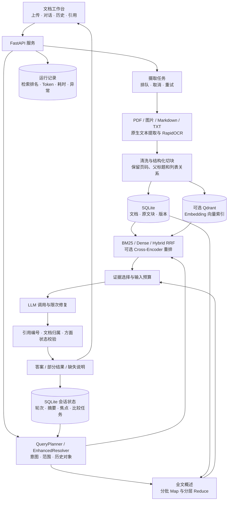
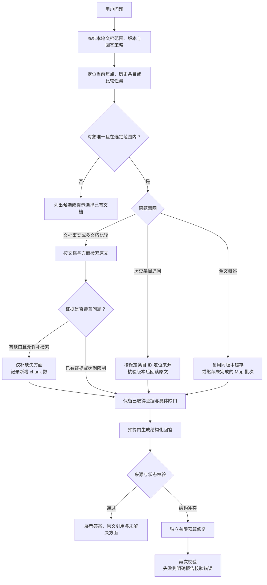
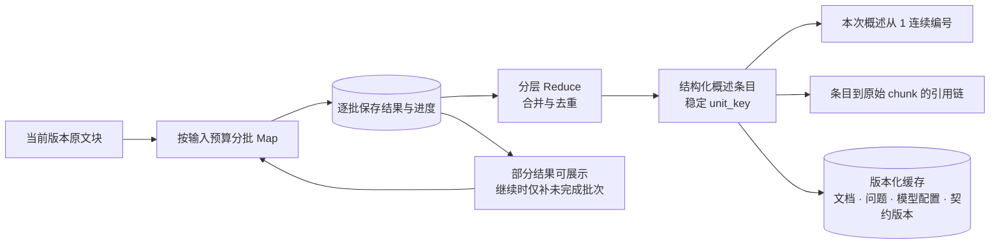
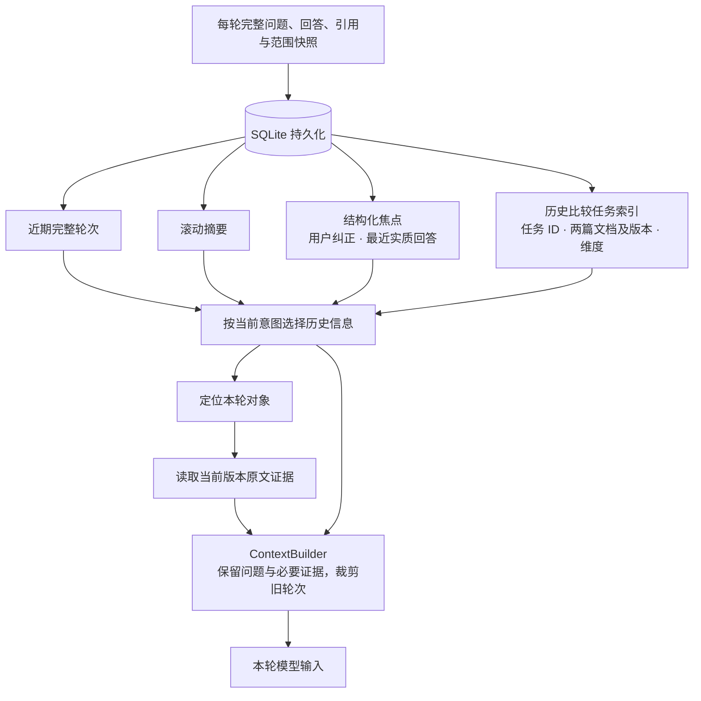

# KnowledgeFlow RAG

面向讲义、论文和学习资料的文档知识问答服务。支持多格式解析、混合检索、多文档比较、长文概述、连续追问、会话归档与引用回溯。

**技术栈：** Python · FastAPI · LangChain · SQLite · BM25 · Qdrant · RRF · ONNX Cross-Encoder · RapidOCR · 原生 JavaScript · Docker Compose。

## 1. 总体架构

页面与 API 同源部署；SQLite 保存原文和业务状态，Qdrant 按需提供向量检索。问答采用明确的检索、取证和校验工作流。



- **解析与来源：** 扫描 PDF、图片及混排 PDF 的图片区域可使用 OCR；保存文件名、物理页码、chunk ID、提取方式和原文。
- **检索与取证：** 按“文档 × 问题方面”分别召回、去重和选择证据，保留多文档覆盖；仅对缺口补检索，没有新增 chunk 时停止重复取证。
- **答案边界：** 指定论文的研究重点、结论和实验数值必须有原文支持；增强模式的通用知识单独标注。引用格式校验之外，语义质量仍需对照原文复核。
- **会话体验：** 自动保存会话，支持标题搜索、重命名、归档与恢复；长会话分页加载。生成期间限制切换，防止响应进入其他会话。

## 2. 问题如何选择处理路径

上传先建立原文索引；只有全文概述请求进入 Map-Reduce。日常事实问答和论文比较使用定向检索。



当前明确选中两篇时，“研究重点”默认分别回答；“区别”增加比较方面。明确提到历史论文时，按文件名及比较任务定位。历史对象不在本轮范围内时提示选中已有文档；重新索引后使用当前版本取证。

### 模块职责

| 模块 | 设计职责 |
|---|---|
| `app/main.py`、会话与摄取 API | 文档管理、会话索引、轮次分页、上传任务和运行查询 |
| `app/rag/retrieval.py`、`aspect_evidence.py` | 多策略召回、方面取证、证据去重与覆盖 |
| `app/rag/query_planner.py`、`enhanced_resolver.py` | 问题规划、选定范围约束、历史定位与解析恢复 |
| `app/rag/structured_overview.py`、`overview_repository.py` | 结构化 Map-Reduce、缓存、批次进度与来源链 |
| `app/rag/memory.py`、`dialogue_focus.py` | 近期轮次、滚动摘要、用户纠正和实质主题 |
| `app/rag/context_builder.py` | 分组件检查输入预算，按完整轮次裁剪历史 |
| `app/enhanced_flow.py`、`app/rag/enhanced_answer.py` | 增强回答编排、补取证与限次结构修复 |
| `app/rag/answer_policy.py` | 引用、来源归属与回答方面状态校验 |
| `app/static/` | 无前端构建依赖的中文工作台 |
| `evaluation/`、`tests/` | 合成任务评测、配对成本实验与回归 |

## 3. 长文概述与会话记忆

### 长文不一次性塞入模型



旧回答保持原样。每次概述单独编号，内部条目 ID 与显示编号分开；完成批次可复用。处理进度表示原文块覆盖情况，概述是否准确、完整仍需抽检。

### 历史保存完整，模型输入按需选择



历史摘要帮助理解追问，文档主张引用原始证据。已回答的比较任务仍可定位；`pending` 只表示尚有缺口。无效历史 ID 先拒绝，再尝试用可信任务索引恢复；无法唯一匹配时给出具体澄清。

## 4. 快速启动

要求 Python 3.10+，推荐 3.12。页面、API 和静态资源均由本项目独立提供。

### 本地运行

```powershell
python -m venv .venv
.\.venv\Scripts\Activate.ps1
python -m pip install -e .
if (!(Test-Path .env)) { Copy-Item .env.example .env }
python -m uvicorn app.main:app --host 127.0.0.1 --port 18000
```

打开 [知识工作台](http://127.0.0.1:18000/)；[接口文档](http://127.0.0.1:18000/docs)由服务运行时生成。

默认问答使用 BM25 与 Mock，可先上传 [公开示例](examples/public-demo.md) 验证流程。扫描文档需安装 OCR 扩展并准备模型；仅使用文本资料时可在 `.env` 设置 `STUDYFLOW_OCR_ENABLED=false`。

### Docker Compose

先启动 Docker Desktop。在项目根目录执行：

```powershell
if (!(Test-Path .env.docker)) { Copy-Item .env.docker.example .env.docker }
$env:RAG_PORT = "18000"
docker compose --env-file .env.docker up --build -d --wait
docker compose --env-file .env.docker ps
```

容器将服务的 8000 端口映射到本机 18000；默认不设置 `RAG_PORT` 时映射到 8000。请选用一个未占用的本机端口。

- 数据持久化到独立 `rag_data` 卷，包含 SQLite、上传文件与本地模型。
- 默认容器演示使用 Mock，OCR、向量和重排关闭；修改配置后重新执行 `up -d`。
- 查看日志：`docker compose logs --tail 100 api`；停止：`docker compose down`。
- 向量模式在填好 Embedding 配置后使用 `docker compose --env-file .env.docker --profile vector up -d`，并启用向量检索。

### 真实模型与可选组件

在 `.env`（本地）或 `.env.docker`（容器）中填写兼容接口：

```dotenv
STUDYFLOW_LLM_MODE=langchain_openai
STUDYFLOW_LLM_BASE_URL=https://your-provider.example/v1
STUDYFLOW_LLM_MODEL=your-chat-model
STUDYFLOW_LLM_API_KEY=fill-locally
STUDYFLOW_LLM_ANSWER_FORMAT=json
STUDYFLOW_LLM_MAX_OUTPUT_TOKENS=2048
STUDYFLOW_LLM_TIMEOUT_SECONDS=60
STUDYFLOW_LLM_MAX_RETRIES=2
```

增强问答需模型遵循结构化答案契约，建议使用支持 JSON object 的接口。聊天与 Embedding 配置独立；配置模板列在 [.env.example](.env.example) 与 [.env.docker.example](.env.docker.example)。

```powershell
python -m pip install -e ".[ocr,vector,reranker]"
python -m app.rag.ocr --prepare
python -m app.rag.reranker --prepare
```

模型准备完成后再启用相应开关；请求期间不自动下载模型。容器内可用 `docker compose run --rm api python -m app.rag.ocr --prepare` 准备持久卷中的 OCR 模型，重排同理。

检索策略可选 `lexical_v1`、`lexical_v2`、`bm25_v1`、`bm25_idf_v2`、`dense_v1` 和 `hybrid_rrf_v1`，默认 `bm25_idf_v2`。Dense/Hybrid 需要 Qdrant 与 Embedding；ONNX 重排默认关闭。

## 5. 使用与接口

1. 新建会话，上传资料，等待摄取状态变为就绪。
2. 选择本轮文档范围和回答策略，提出事实问题、概述或比较问题。
3. 点击引用，对照文件、页码和原文；通过运行详情检查检索与调用过程。
4. 从左侧历史恢复会话；归档可恢复，当前不提供会话删除。

`document_strict` 仅依据文档回答；`document_enhanced` 可单独补充模型通用知识。新工作台会话默认增强模式，旧 API 未指定策略仍兼容严格模式。全文概述始终按文档取证。

| 方法 | 路径 | 用途 |
|---|---|---|
| POST / GET | `/conversations` | 新建会话、分页查询历史 |
| GET | `/conversations/{id}` | 恢复会话状态 |
| GET | `/conversations/{id}/turns` | 分页读取轮次 |
| PATCH | `/conversations/{id}` | 修改标题或归档/恢复（title、archived） |
| PATCH | `/conversations/{id}/policy` | 切换后续轮次的回答策略 |
| POST / GET | `/ingestions`、`/ingestions/{id}` | 受理上传任务、查询进度 |
| POST | `/documents/upload` | 兼容同步上传接口 |
| GET | `/documents`、`/documents/{id}/pages` | 查看文档及页级原文 |
| GET | `/documents/{id}/chunks/{chunk_id}`、`/source` | 核验 chunk、下载原文件 |
| POST | `/documents/{id}/reindex`、`/reparse` | 重新切块索引、从原文件重新解析 |
| POST | `/chat` | 带 session_id、范围和策略提问 |
| GET | `/runs/{id}`、`/health` | 诊断记录、进程健康检查 |

`/chat` 返回完整 JSON。调用失败返回对应错误状态和 `run_id`；运行记录保存尝试次数、各阶段耗时、实际 Token 和脱敏异常。上游未返回 Token 时记录为 `null`，预算估算另行标记。

## 6. 测试与评测口径

### 离线回归与服务冒烟

```powershell
python -m unittest discover -s tests -v
$env:KF_STATIC_DIR = (Resolve-Path .\app\static).Path
node tests/frontend_answer_tests.js
node tests/frontend_upload_tests.js
python scripts/smoke_api.py --base-url http://127.0.0.1:18000
```

模块回归使用模拟模型与公开合成夹具，覆盖历史定位、跨话题比较、范围/版本变化、方面证据覆盖、部分概述续处理、预算超限及答案修复。服务冒烟使用公开资料验证上传、来源、回答/拒答与运行记录。

真实模型测试需显式执行，会使用本地配置的模型服务：

```powershell
python -m evaluation.task_memory_benchmark --output evaluation/results/task-memory-new
python -m evaluation.benchmark_review --report evaluation/results/task-memory-new/report.json --output evaluation/results/task-memory-new/review-template.json
```

任务完成需所有预定步骤满足答案、引用、范围和拒答要求；同时保存机械检查与逐项语义评审。Token 实验对同一问题、同一证据分别携带完整历史和压缩历史，单独统计摘要开销。

### 已有结果

| 项目 | 固定测试条件 | 结果 |
|---|---|---|
| 检索召回优化 | 23 份文档、35 题开发查询；同一问题与证据标注、BM25 IDF²、原始 Top-4；修正列表切块 | 证据级宏平均 Recall@4：97.14% → 100%，提升 **2.86 个百分点**；MRR@4：0.9238 → 0.9310 |
| 答案案例 | 历史答案评测集 | 40 个案例；案例数量单独记录 |
| 合成任务完成 | 4 份公开合成资料、12 块原文、18 个可回答任务；规则检查及助手语义复核 | **18/18**；另 2 个缺证据控制任务均正确拒答，共 23 个实际用户轮次 |
| 回答输入成本 | qwen3.7-plus、JSON、temperature=0、关闭 thinking；16 轮固定历史、8 组同问题同证据配对，摘要＋近期 3 轮对比完整历史 | 输入 17,785 → 10,809 Token，下降 **39.22%** |
| 计入摘要成本 | 上述 8 组实验，计入一次摘要生成的 1,725 输入 Token | 累计输入 17,785 → 12,534 Token，下降 **29.52%**；含输出总量 18,901 → 13,772，下降 **27.14%** |
| 模块回归 | 当前源码，模拟模型与合成材料 | **310 项 unittest 通过**，含发布排除规则回归 |

开发集指标用于调优；合成任务结果经过助手复核，尚非独立人工盲测。Token 数据属于固定历史的配对实验，不能替代所有真实会话的成本统计。两种上下文在该配对实验中的 8 个答案均通过检查。

## 7. 仓库结构与发布

```text
app/                 API、RAG 模块与静态工作台
tests/               Python 与前端回归
evaluation/          评测脚本及公开合成夹具
examples/            可上传的公开示例
scripts/             服务冒烟与白名单发布工具
.github/workflows/   CI
Dockerfile
compose.yaml
.env.example
.env.docker.example
README.md
```

公开仓库不包含 `docs/`、真实配置、上传资料、SQLite 数据库、本地模型及运行报告。设计和操作说明集中在本 README。

发布包通过白名单生成并附带逐文件 SHA-256 清单；只允许在项目自身的 `dist/` 下创建全新目录：

```powershell
python scripts/prepare_release.py --name knowledgeflow-rag-public
```

项目独立管理配置、数据和启动流程。原生页面随 Python 包与镜像分发，无需 Node 构建；Node 仅用于前端单测。
