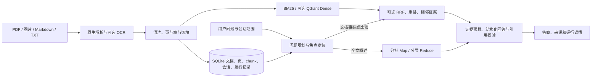

# KnowledgeFlow RAG：项目 A 总览

本文记录当前项目 A 的实现边界、设计思路和验收方法。项目 A 独立运行，代码、配置、数据卷和服务均不依赖项目 B。

## 目标与原则

面向讲义、论文和学习资料，提供可定位到原文的知识问答。系统把三个问题分开处理：长文概述需要覆盖文档，日常事实问答需要精准取证，多轮追问需要准确定位用户所指对象。历史回答和模型知识可以帮助理解问题，但不能替代本轮原文证据。

## 模块分工

| 层 | 主要文件 | 作用 |
|---|---|---|
| 接口与工作台 | `app/main.py`、`app/conversation_api.py`、`app/static/` | FastAPI/Pydantic 接口；上传、问答、资料库、来源、运行记录及历史会话 UI |
| 解析与索引 | `app/ingestion.py`、`app/rag/parsers.py`、`pdf_layout.py`、`ocr.py`、`quality.py`、`chunking.py` | 异步摄取、原生文字与可选 OCR、质量清洗、保留页码/章节的切块 |
| 检索与证据 | `retrieval.py`、`embedding.py`、`vector_index.py`、`hybrid.py`、`reranker.py`、`evidence_expansion.py`、`aspect_evidence.py` | 默认 BM25；可选 Dense/Qdrant、RRF、ONNX 重排；按问题方面和文档选择证据 |
| 对话规划 | `query_planner.py`、`enhanced_resolver.py`、`dialogue_focus.py`、`comparison_locator.py` | 区分全文概述、事实、条目追问和双篇比较；显式纠正与历史对象定位 |
| 概述与记忆 | `overview.py`、`overview_contracts.py`、`overview_repository.py`、`memory.py`、`context_builder.py` | Map-Reduce 结构化概述、批次进度与继续；完整轮次、焦点、滚动摘要和统一输入预算 |
| 回答与校验 | `conversational_flow.py`、`enhanced_flow.py`、`enhanced_answer.py`、`answer_policy.py`、`reference_evidence.py` | 来源策略、限次补检索/格式修复、引用与文档归属校验，证据不足时说明缺口 |
| 持久化与诊断 | `store.py`、`conversation.py`、`comparison_task_repository.py` | SQLite 保存文档、原始轮次、版本快照、比较任务和运行事件；历史会话索引仅存轻量元数据 |

## 长文与多轮上下文

1. **概述**：仅在请求全文概述时对已索引原文进行分批 Map 和分层 Reduce。每个概述条目保存内部 key、展示编号及原始 chunk 引用。每次概述从 1 编号；部分完成可显示进度，并复用成功批次继续。
2. **普通问答**：先规划本轮问题方面，定向检索当前范围的原文。比较两篇文档时分别检索和核对两侧覆盖；只对缺证据的一侧补检索。旧概述正文不反复塞进模型。
3. **历史追问**：原始轮次完整保留；焦点状态和比较任务索引定位“第二点”“前面那两篇”等对象。滚动摘要辅助理解，不充当论文事实。无效历史 ID 可以在可信索引中恢复；无法唯一定位时给出具体澄清。
4. **来源与预算**：每轮冻结文档范围、版本和回答策略。优先保留当前问题、明确指定的对象及必要原文；旧叙述可压缩。来源版本变化时重新取证，必要输入超限则明确报错。
5. **会话存档**：会话创建后自动入 SQLite 索引。左侧可搜索、改名、归档及恢复；打开长会话先取最近 50 轮，向上再分页。归档只读，不删除轮次、记忆或比较任务。生成期间暂不切换会话。

## 可信边界与评测

- 文档依据和模型通用知识分区展示。指定论文的主张、数字和结论必须有当前原文支持；引用编号、chunk 与所属文档需核验。结构校验不能证明自然语言事实正确。
- 每次运行记录范围快照、检索排名、补检索、模型调用、实际返回的 Token、耗时及错误。没有上游用量时记 `null`。
- 默认检索为 `bm25_idf_v2`；Qdrant Dense、Hybrid RRF、OCR 与 ONNX 重排按配置启用，不能把可选模块写成默认在线能力。
- 仓库已有 **35 题检索开发集**与 **40 题答案案例**。同一开发集上的列表切块修正使 Recall@4 从 0.9714 提升到 1.0000，MRR@4 从 0.9238 提升到 0.9310。这是用过的开发集指标，不是独立盲测或答案正确率。
- 离线单测、公开合成资料的接口测试、真实模型调用、人工逐句对照原文分别验收。真实私人论文的答案质量仍需人工抽检，不能用合成测试替代。

## 运行与发布

- `compose.yaml` 仅启动项目 A API，默认使用本地 8000 端口和独立 `rag_data` 卷；可选 Qdrant 使用单独 profile。镜像只复制应用源码及静态页面，不包含本地 `.env`、上传资料或 SQLite 数据。
- 本地运行及变量见 [README](../README.md) 与 [部署说明](deployment.md)。运行 `python -m unittest discover -s tests -v` 验证代码；真实模型和向量服务需单独配置。
- 公开 GitHub 快照由 `scripts/prepare_release.py` 的白名单生成，只发布代码、文档和公开合成夹具。私有运行数据、密钥、参考资料及项目 B 不进入仓库或 Docker 构建上下文。
